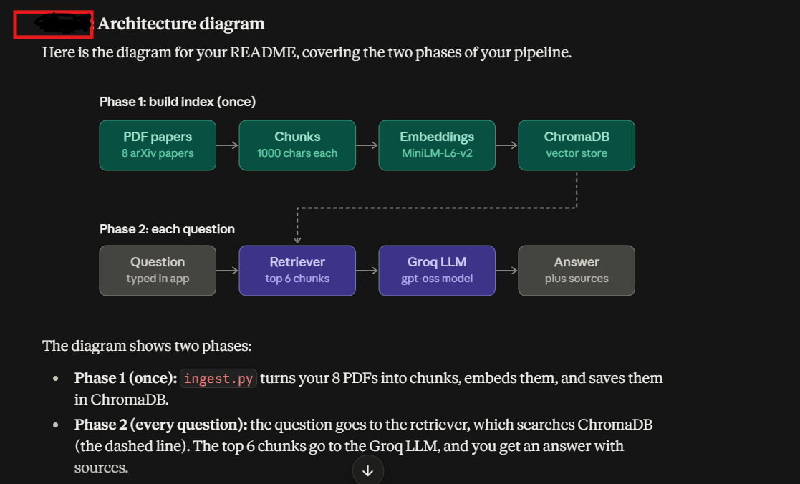
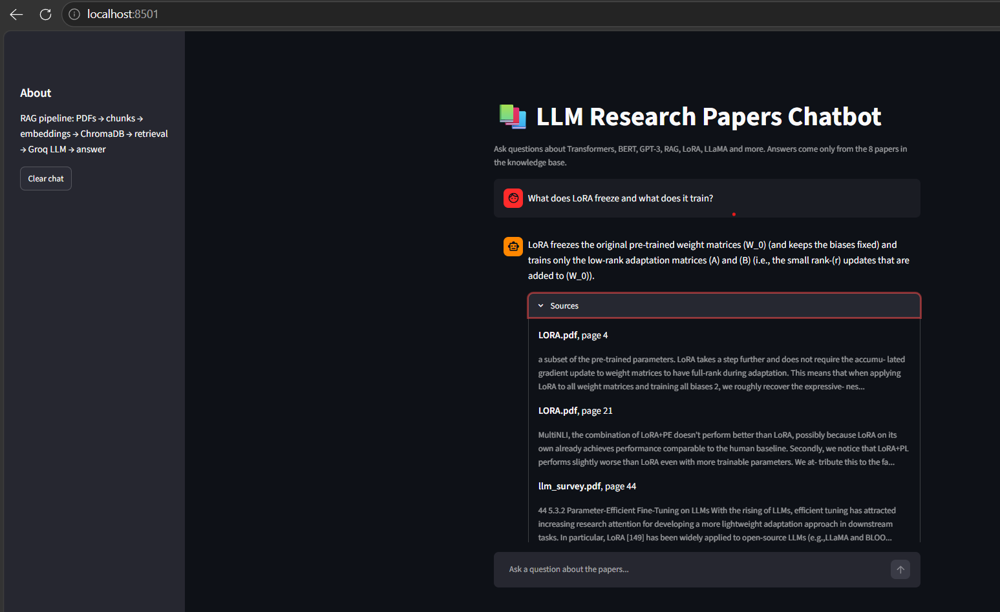
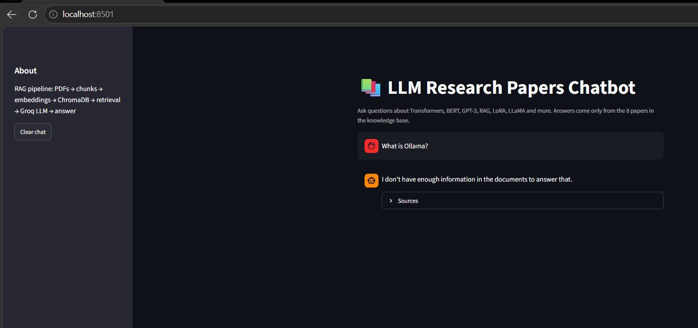

# RAG Chatbot for Large Language Model Research Papers

A Retrieval-Augmented Generation (RAG) chatbot that answers questions about foundational LLM research papers. Answers are generated **only** from the retrieved text of the papers, and the app shows the source file and page for every answer. Questions the papers cannot answer are refused instead of guessed.

**Author:** [kamal]  
**10:** October 2026

---

## 1. Problem domain

**Who is it for?**  
Students, beginners and AI practitioners who want quick, reliable answers about how LLMs work without reading every research paper in full.

**What documents does it use?**  
Eight foundational LLM papers from arXiv (365 pages in total, split into 1,970 chunks):

| Paper | Topic |
|---|---|
| Attention Is All You Need | Transformer architecture |
| BERT | Bidirectional pre-training |
| Language Models are Few-Shot Learners | GPT-3 |
| Retrieval-Augmented Generation (RAG) | Retrieval + generation |
| Chain-of-Thought Prompting | Reasoning via prompting |
| LoRA | Parameter-efficient fine-tuning |
| LLaMA | Open foundation models |
| A Survey of Large Language Models | Overview of the field |

**What problem does it solve?**  
Research papers are long, technical and hard to search. A general-purpose LLM asked about them may hallucinate details such as wrong numbers or invented claims. This chatbot retrieves the relevant passages from the actual papers and answers only from them, so responses are accurate and traceable to a source.

---

## 2. Architecture



**Phase 1: build the index (run once, `src/ingest.py`)**
1. Load the PDFs from `DATA/` (365 pages).
2. Split them into overlapping chunks (1,000 characters, 150 overlap) with `RecursiveCharacterTextSplitter`.
3. Embed each chunk with `sentence-transformers/all-MiniLM-L6-v2`.
4. Store the vectors in a persistent ChromaDB database (`chroma_db/`).

**Phase 2: answer a question (every query, `src/rag_chain.py`)**
1. Embed the question with the same embedding model.
2. Retrieve the top **k = 6** most similar chunks from ChromaDB.
3. Insert the chunks into a prompt that tells the LLM to answer only from the context and to say it does not have enough information otherwise.
4. The Groq-hosted LLM generates the answer, and the app displays it together with the source file and page numbers.

### Technology choices

| Component | Choice | Reason |
|---|---|---|
| Orchestration | LangChain | Standard RAG building blocks |
| LLM | `openai/gpt-oss-120b` via Groq API | Free tier, fast, no local GPU needed |
| Embeddings | `all-MiniLM-L6-v2` | Small, free, runs locally on CPU |
| Vector store | ChromaDB | Persists to disk, simple to reproduce |
| UI | Streamlit | Quick chat interface with a sources panel |
| Evaluation | RAGAS | Measures faithfulness and answer relevancy |

---

## 3. Project structure

```
RAG_Chatbot/
├── DATA/                  # the 8 PDF papers
├── chroma_db/             # saved vector store (created by ingest.py)
├── src/
│   ├── ingest.py          # load, chunk, embed, index
│   ├── rag_chain.py       # retrieval + generation (ask())
│   └── evaluate.py        # RAGAS evaluation
├── screenshots/           # app screenshots
├── app.py                 # Streamlit chat UI
├── architecture.png       # architecture diagram
├── eval_results_k4.csv    # per-question scores, k = 4
├── eval_results_k6.csv    # per-question scores, k = 6
├── requirements.txt
├── .env                   # GROQ_API_KEY (NOT committed or shared)
└── README.md
```

---

## 4. Setup and usage (Windows)

**Prerequisites:** Python 3.10+ (developed with 3.13) and a free API key from [console.groq.com](https://console.groq.com).

```bash
# 1. Create and activate a virtual environment
python -m venv venv
venv\Scripts\activate

# 2. Install dependencies
pip install -r requirements.txt

# 3. Add your Groq API key to a file named .env in the project root
#    GROQ_API_KEY=your_key_here

# 4. Build the vector store (only needed if chroma_db/ is missing)
python src\ingest.py

# 5. Start the chatbot
streamlit run app.py
```

Then open <http://localhost:8501>.

**Run the evaluation:**

```bash
python src\evaluate.py
```

### Notes
- Do not run `ingest.py` twice without deleting `chroma_db/` first, or chunks will be duplicated.
- The Groq free tier has a daily token limit per model. A full RAGAS run uses a large share of it. If you hit a 429 error, wait for the quota to reset or switch `LLM_MODEL` in `src/rag_chain.py` to `openai/gpt-oss-20b`.
- The model names available on Groq change over time. List the ones your key can use with:
  `python -c "from dotenv import load_dotenv; load_dotenv('.env'); from groq import Groq; [print(m.id) for m in Groq().models.list().data]"`
- RAGAS 0.4.3 imports a module that newer `langchain-community` versions removed. `evaluate.py` contains a small stub at the top that works around this. Do not remove it.

---

## 5. Screenshots

**A grounded answer with sources**



**A question outside the papers is refused**



---

## 6. Evaluation

### Method
- **Test set:** 10 questions with reference answers written from the papers, plus 2 out-of-scope questions.
- **Metrics (RAGAS):**
  - *Faithfulness*: are the claims in the answer supported by the retrieved chunks? (hallucination check)
  - *Answer relevancy*: does the answer address the question that was asked?
- **Judge model:** the same `openai/gpt-oss-120b` model, with the local MiniLM embeddings.
- **Experiment:** one variable changed, the number of retrieved chunks **k** (4 vs 6). Everything else was identical.

### Results

| Setting | Faithfulness | Answer relevancy |
|---|---|---|
| k = 4 | 0.702 (10 questions) | 0.785 (10 questions) |
| k = 6 | 0.817 (9 questions) | 0.883 (10 questions) |

One faithfulness job timed out in the k = 6 run ("What is masked language modeling in BERT?"), so that average covers 9 questions. For a like-for-like comparison, on those **same 9 questions faithfulness was 0.669 at k = 4 and 0.817 at k = 6**. **k = 6 was kept as the final setting.**

**Out-of-scope test:** 2 of 2 questions ("Who won the 2022 FIFA World Cup?", "What is Ollama?") were correctly refused with *"I don't have enough information in the documents to answer that."*

### Per-question scores (k = 6)

| # | Question | Faithfulness | Answer relevancy |
|---|---|---|---|
| 0 | What does the Transformer use instead of recurrence and convolution? | 0.50 | 0.96 |
| 1 | What is masked language modeling in BERT? | timed out | 0.81 |
| 2 | What is few-shot learning in GPT-3? | 0.86 | 0.98 |
| 3 | What are the two components of a RAG model? | 1.00 | 1.00 |
| 4 | What are the two variants of RAG? | 1.00 | 1.00 |
| 5 | What is chain-of-thought prompting? | 1.00 | 0.97 |
| 6 | What does LoRA freeze and what does it train? | 1.00 | 0.48 |
| 7 | How many parameters does GPT-3 have? | 1.00 | 1.00 |
| 8 | Which paper introduced multi-head attention? | 0.00 | 0.94 |
| 9 | What data was LLaMA trained on? | 1.00 | 0.70 |

### Analysis

**What worked.** Retrieving 6 chunks instead of 4 raised faithfulness by about 0.15 on the same questions and answer relevancy by about 0.10. Six of the ten questions scored a perfect 1.00 on faithfulness, and the system refused both out-of-scope questions instead of inventing an answer.

**Weak spots and likely causes.** The causes below are hypotheses based on how the metrics work; confirm them by inspecting the `response` and `retrieved_contexts` columns in `eval_results_k6.csv`.

- *"Which paper introduced multi-head attention?" (faithfulness 0.00).* This question asks for the **title of a paper**, which is metadata rather than something stated in the body text. The retrieved chunks likely describe multi-head attention without naming the paper in a way the judge could match, so the claim was not supported by the retrieved context.
- *"What does the Transformer use instead of recurrence and convolution?" (faithfulness 0.50).* The answer probably combined retrieved statements with extra detail from the model's own knowledge, which faithfulness counts as unsupported.
- *"What does LoRA freeze and what does it train?" (relevancy 0.48).* This is a two-part question. RAGAS relevancy rewards answers that match the question closely, so an answer that covered one part or added extra material scores lower even when it is factually correct.
- *"What data was LLaMA trained on?" (relevancy 0.70).* The answer was probably longer or broader than the question needed.
- *Timeout.* The free API tier and the judge's many calls caused one scoring job to time out. This reflects infrastructure limits rather than answer quality.

---

## 7. Limitations

- **Small evaluation.** Ten questions and a single run per setting. Differences of a few hundredths are within the run-to-run noise of an LLM judge, so the k = 4 vs k = 6 result should be read as an indication, not proof.
- **Same model family as generator and judge**, which can favour its own style of answer.
- **Fixed-size chunking** can cut through tables, equations or section boundaries, since the PDFs are parsed as plain text.
- **No conversation memory.** Every question is answered independently, so follow-up questions such as "and how does it differ from BERT?" lose context.
- **Metadata questions** (such as which paper introduced a concept) are poorly served because retrieval works on body text.
- **Free-tier rate limits** on the Groq API restrict how often the full evaluation can be run.
- The knowledge base is limited to 8 papers and cannot answer questions beyond them, by design.

## 8. Future work

- Add a **re-ranker** or hybrid search (BM25 + vectors) to improve which chunks are retrieved.
- Attach **paper-title metadata** to every chunk and retrieve with it, to answer "which paper" questions.
- Use section-aware chunking and a layout-aware PDF parser for tables and equations.
- Add **conversation memory** for multi-turn questions.
- Expand the test set to 50+ questions and add *context precision* and *context recall* metrics.
- Compare chunk sizes and embedding models in the same controlled way as k.

---

## 9. Security note

The API key lives only in `.env`, which must never be committed to Git or shared. If you publish this project, add `.env` and `venv/` to `.gitignore`.
